# INFORME — Demostración de funcionamiento

Este informe reemplaza a la defensa oral: muestra con capturas que el despliegue funciona. Cada
captura incluye el comando que la produjo y está acompañada de una explicación de lo que se ve.
Las imágenes están en [`informe/`](informe).

**Entorno de las pruebas**

| Elemento | Valor |
| --- | --- |
| Máquina | VM Ubuntu 26.04 del curso (`estudiante@curso-docker`) |
| Clúster | Un nodo, IP interna `172.16.21.21` |
| Ingress Controller | nginx (clase `nginx`), ADDRESS `172.16.21.224`; `reservas.local` resuelto por `/etc/hosts` |
| Almacenamiento | StorageClass por defecto `local-path` |
| Métricas | metrics-server |
| Imágenes | `antoniojv03/reservas-api:v1` y `:v2`, `antoniojv03/reservas-frontend:v1`, `mysql:8.4` |
| Namespace / release | `reservas-app` / `reservas-app` |

Los puntos 1 a 5 son los que pide el enunciado. Después hay evidencia adicional para cada criterio de
evaluación.

---

## 1. La aplicación respondiendo a través del Ingress, con una reserva creada desde el navegador

<!-- PENDIENTE: captura nueva -->
> ⚠️ **PENDIENTE:** captura del navegador en `http://reservas.local` creando una reserva.

**El Ingress y su regla.** `reservas-app-ingress` tiene una única regla, `host: reservas.local`,
`path: /`, hacia `reservas-frontend:8080`. La columna `ADDRESS` muestra la IP del controlador nginx;
si estuviera vacía, no habría controlador que atendiera la regla.

```
kubectl apply -f k8s/reservas-app-ingress.yaml
kubectl get ingress -n reservas-app
```

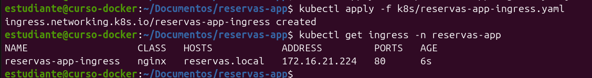

**La API responde a través del Ingress.** El pedido entra por el Ingress, llega al nginx del
frontend, que reconoce el prefijo `/api/` y lo reenvía a `reservas-api:3000/reservas`. La respuesta es
el JSON de las reservas guardadas en MySQL: atraviesa las tres capas.

```
curl -s http://reservas.local/api/reservas
```

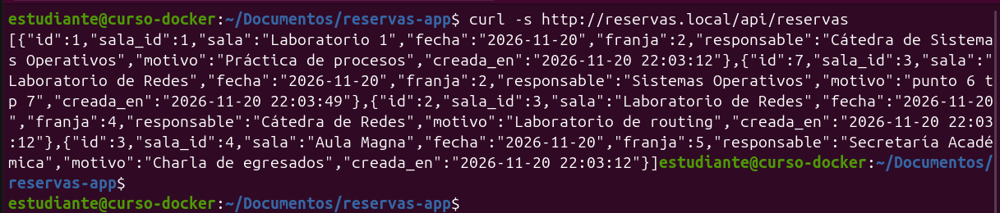

**Por qué no sirve probar `/reservas` sin `/api`.** Responde `200 OK` con `Content-Type: text/html`:
es el `index.html` de la SPA, que nginx devuelve para cualquier ruta desconocida (`try_files`). Un
`200` ahí no prueba nada sobre la API: es un falso positivo.

```
curl -s -i http://reservas.local/reservas | head -n 25
```

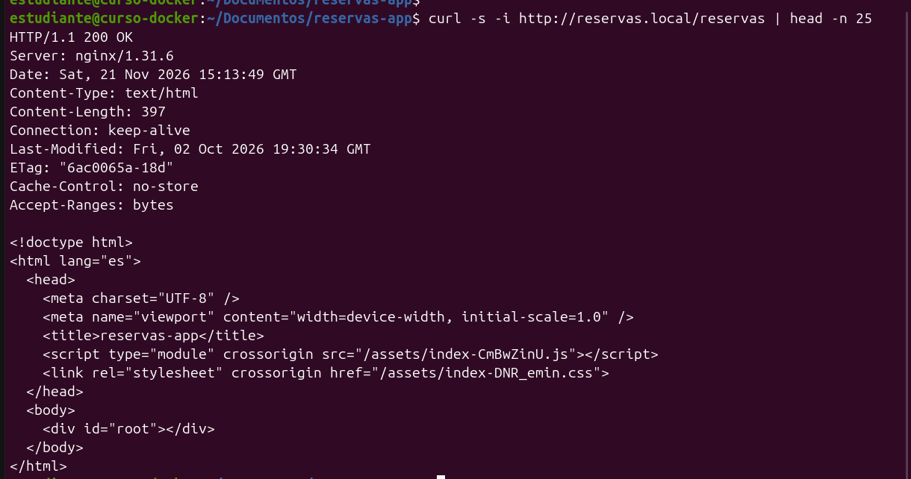

**La aplicación en el navegador por `reservas.local`**, instalada con Helm (entrega 8). El indicador
`API v1` del encabezado lo obtiene la SPA de `GET /api/health`, también a través del Ingress.

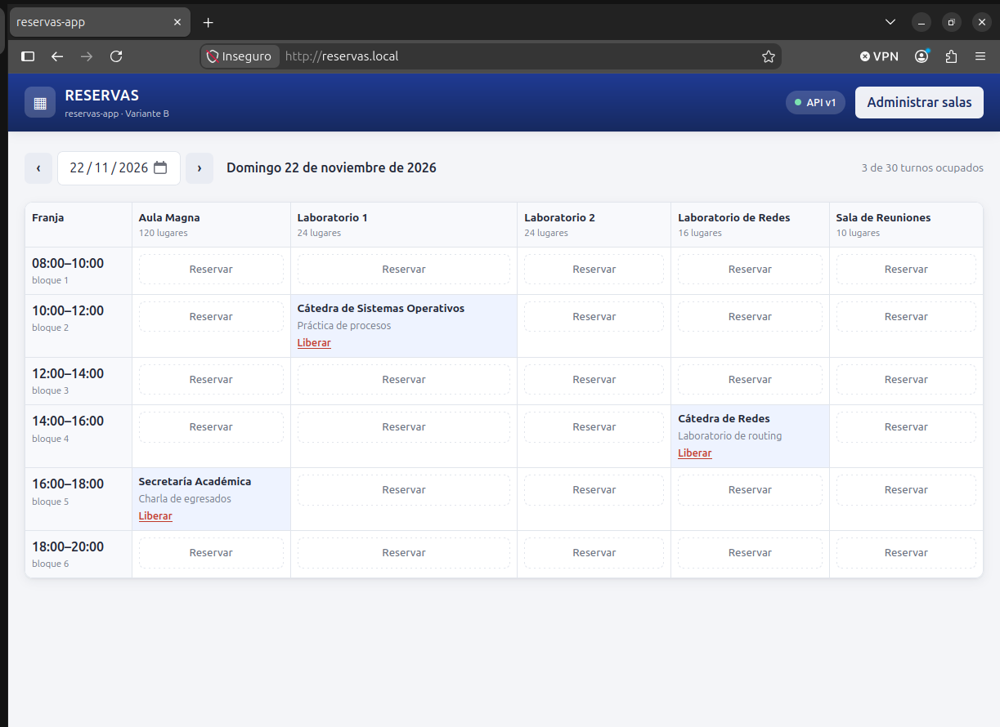

---

## 2. Autoescalado bajo carga (`kubectl get hpa -w`)

`reservas-api-hpa` (`autoscaling/v2`) apunta a `Deployment/reservas-api` con `minReplicas: 2`,
`maxReplicas: 6` y objetivo de 50 % de CPU. El porcentaje se calcula contra el request de
`100m`. Se usaron tres terminales: el HPA, `kubectl top pods` y la generación de carga.

**Reposo.** `TARGETS` muestra un número (`1%/50%`), no `<unknown>`: hay métricas y hay request.

```
kubectl get hpa -n reservas-app -w
```

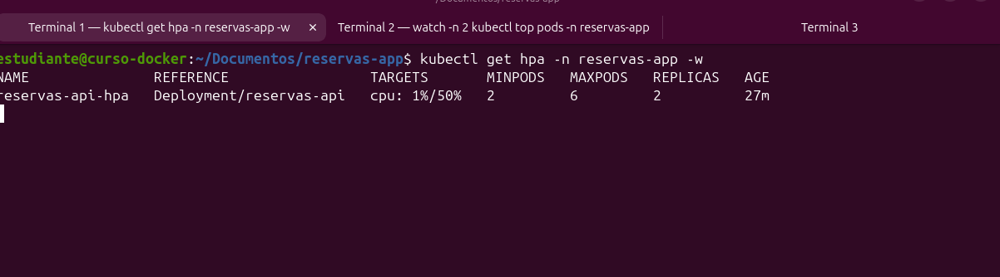

**Carga.** Cuatro Pods `busybox` piden en bucle `GET /reservas`, que resuelve un `JOIN` entre dos
tablas, directamente al Service `reservas-api` desde dentro del clúster.

```
for i in 1 2 3 4; do
  kubectl run carga-$i --image=busybox --restart=Never -n reservas-app -- /bin/sh -c \
    "while true; do wget -q -O- http://reservas-api:3000/reservas >/dev/null 2>&1; done"
done
```

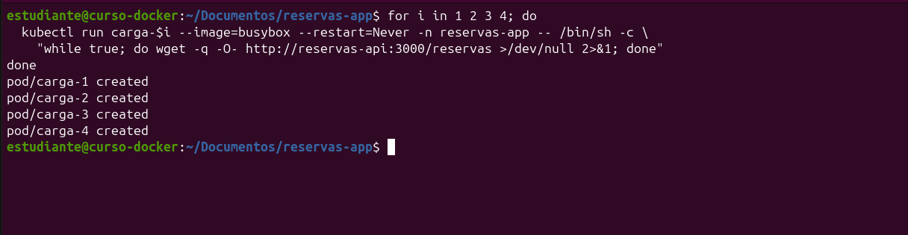

**Escalado.** La CPU sube de 1 % a 26 %, 241 % y 279 % del request. El HPA pasa de **2 a 4 y luego
a 6 réplicas** (el máximo), y con 6 réplicas el promedio baja a 203 %.

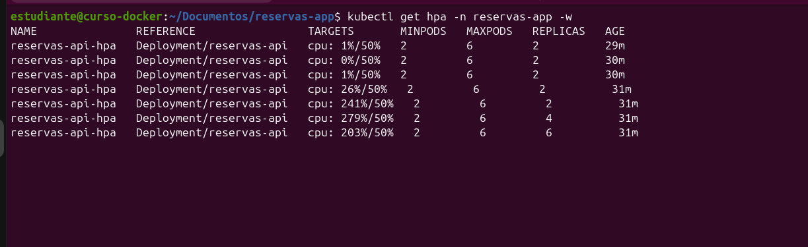

`kubectl top pods` confirma que la carga es real: las 6 réplicas de la API consumen entre 46m y 146m
de CPU cada una, mientras que el frontend no se mueve (0–1m). Es la razón por la que el frontend no
tiene autoescalador ([ARQUITECTURA §1c](ARQUITECTURA.md#c-por-qué-hay-un-solo-autoescalador-entre-los-doce-objetos-qué-ocurriría-si-se-le-asignara-uno-a-reservas-db-y-por-qué-tampoco-lo-tiene-el-frontend)).

```
watch -n 2 kubectl top pods -n reservas-app
```

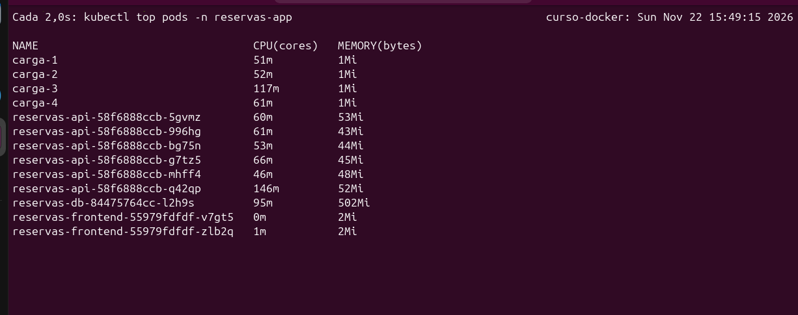

**Fin de la carga y bajada.** Se eliminan los Pods de carga. La CPU cae enseguida a 0–1 %, pero las
réplicas se mantienen en 6 durante la **ventana de estabilización** (unos 5 minutos, para no oscilar)
y después bajan a **4 y a 2**, el mínimo.

```
kubectl delete pod -n reservas-app carga-1 carga-2 carga-3 carga-4
```

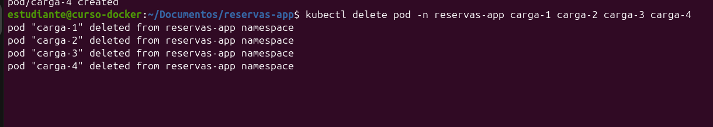

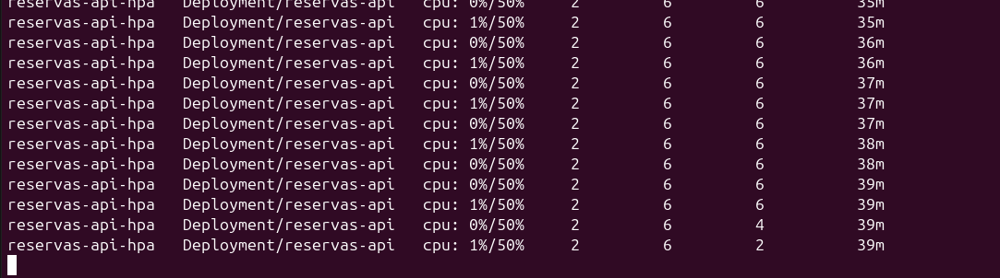

---

## 3. Ciclo de vida de la release: `helm upgrade`, `helm rollback` y `helm history`

**Antes:** revisión 1 (instalación) con las dos imágenes propias en `v1`.

```
helm history reservas-app -n reservas-app
kubectl get deploy -n reservas-app -o jsonpath='{range .items[*]}{.metadata.name}{"\t"}{.spec.template.spec.containers[0].image}{"\n"}{end}'
```

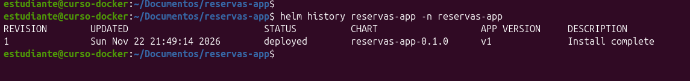

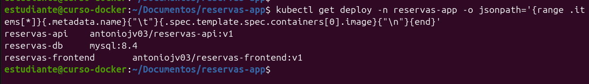

**Actualización:** se cambia solo el tag de la API.

```
helm upgrade reservas-app ./reservas-app -n reservas-app --set api.image.tag=v2
```

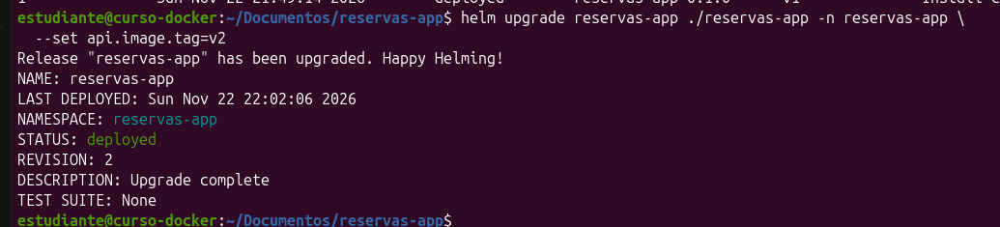

El Deployment `reservas-api` pasa a `antoniojv03/reservas-api:v2` y el navegador muestra `API v2`.
**El frontend sigue en `reservas-frontend:v1`**: son dos imágenes con ciclos de vida independientes,
y cambiar `api.image.tag` no toca `frontend.image.tag`.

```
kubectl get deploy -n reservas-app -o jsonpath='{range .items[*]}{.metadata.name}{"\t"}{.spec.template.spec.containers[0].image}{"\n"}{end}'
```

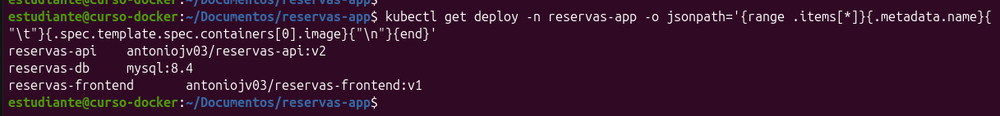

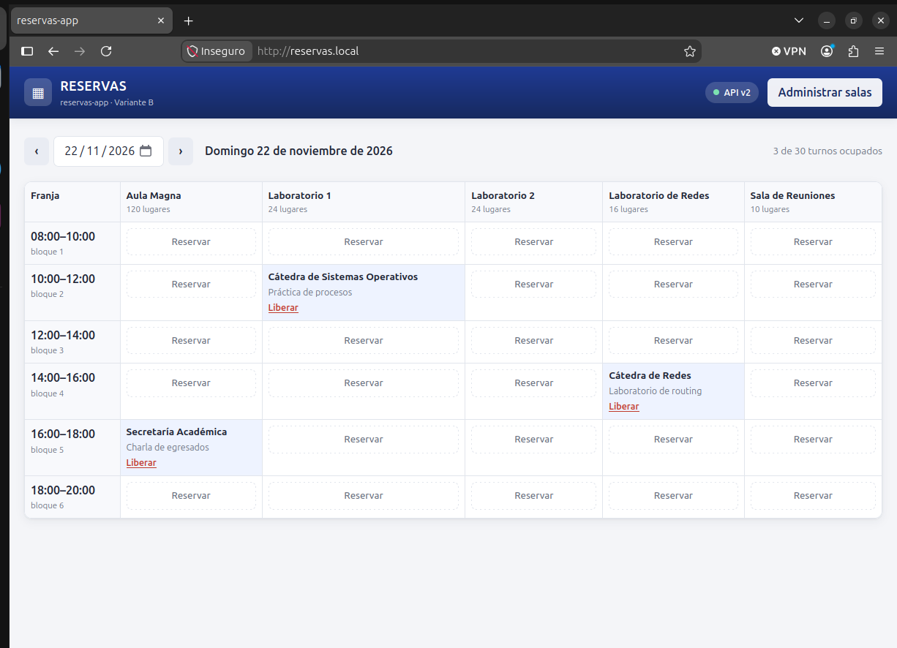

El historial registra la revisión 2:

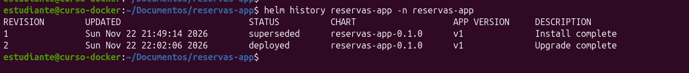

**Reversión** a la revisión 1:

```
helm rollback reservas-app 1 -n reservas-app
```

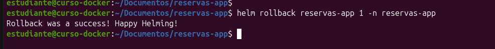

**Historial.** El rollback **no borra** la revisión 2: crea la revisión 3 con el contenido de la 1
(`Rollback to 1`). Queda la auditoría completa: 1 `Install complete`, 2 `Upgrade complete` (v2),
3 `Rollback to 1` (`deployed`). Las imágenes vuelven a `reservas-api:v1`.

```
helm history reservas-app -n reservas-app
```

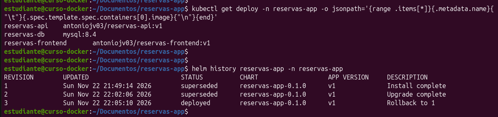

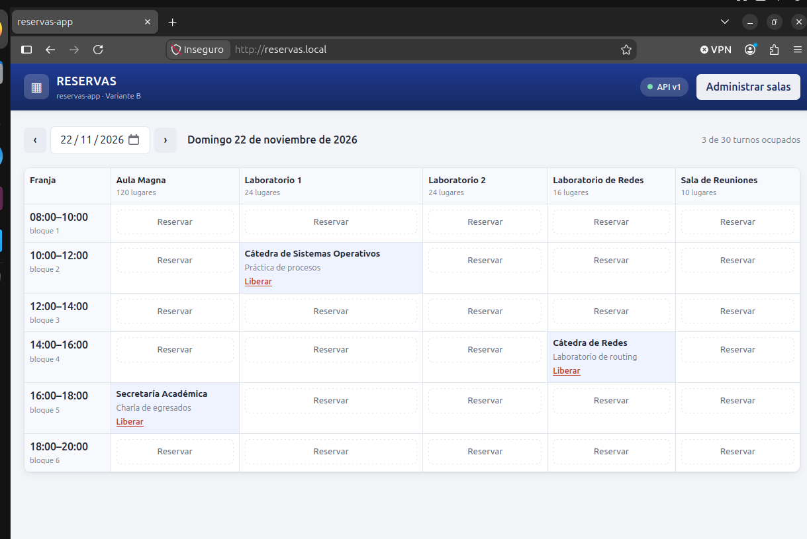

---

## 4. Un valor de `values.yaml` es real: la misma plantilla renderizada dos veces

<!-- PENDIENTE: captura o registro nuevo -->
> ⚠️ **PENDIENTE:** registro de `helm template` con los valores por defecto y con `--set`.

---

## 5. Prueba de concurrencia de la sexta entrega

Acompaña a la pregunta 2 de [ARQUITECTURA.md](ARQUITECTURA.md#2-qué-deja-de-estar-garantizado-al-pasar-de-una-réplica-de-la-api-a-tres).

**Tres réplicas de la API** atendiendo en paralelo:

```
kubectl scale deployment reservas-api --replicas=3
kubectl get po
```

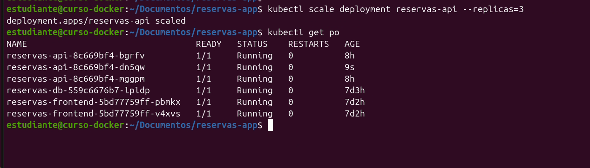

**30 reservas en paralelo por la misma sala, fecha y franja** (`sala_id=1`, `2026-12-01`, franja 5).
Cada `curl` corre en segundo plano (`&`), así que los 30 pedidos llegan casi a la vez y el Service los
reparte entre las 3 réplicas. Resultado: **1 respuesta `201` y 29 respuestas `409`**.

```
for i in $(seq 1 30); do
  curl -s -o /dev/null -w "%{http_code}\n" -X POST \
    http://172.16.21.21:30501/reservas -H 'Content-Type: application/json' \
    -d '{"sala_id":1,"fecha":"2026-12-01","franja":5,"responsable":"R'$i'"}' &
done | sort | uniq -c
```

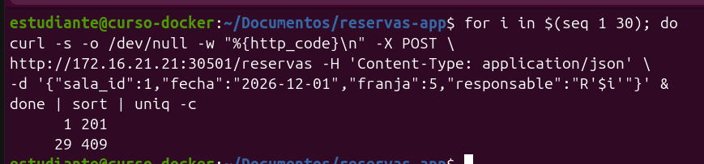

**Recuento en la base:** exactamente **1** registro. Algunos 409 los da el `SELECT` previo, cuando el
turno ya estaba confirmado. Los pedidos que pasaron el `SELECT` al mismo tiempo, leyendo "libre",
chocaron en el `INSERT` contra la restricción `UNIQUE (sala_id, fecha, franja)`, que el motor aplica
de forma atómica (`ER_DUP_ENTRY` → 409). Sin esa restricción, el recuento podría ser mayor que 1.

```
kubectl exec deploy/reservas-db -n reservas-app -- \
  mysql -ureservas_user -preservas_pass reservasdb -e \
  "SELECT COUNT(*) FROM reservas WHERE sala_id=1 AND fecha='2026-12-01' AND franja=5;"
```

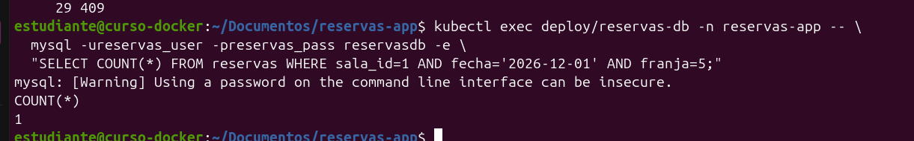

> En la sexta entrega la API también se exponía con el NodePort de depuración `reservas-api-nodeport`
> (30501), que no forma parte del proyecto final y está en `k8s/historico/`.

---

## Evidencia adicional por criterio de evaluación

### C1. Imágenes de contenedor

**Tamaño.** La imagen multietapa de la API pesa **205 MB** contra **1,59 GB** de la versión de una
sola etapa (`Dockerfile.ingenuo`, base `node:20` con compiladores): un 87 % menos. El frontend pesa
**73,9 MB**: la etapa final es `nginx-unprivileged` con solo los estáticos de `dist/`.

```
docker images
```

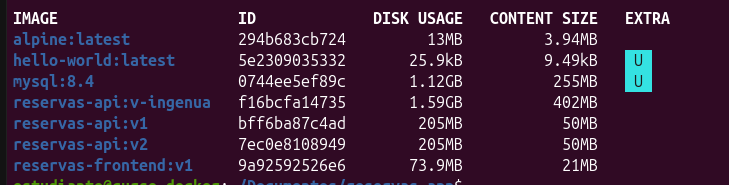

**Sin herramientas de compilación.** La imagen final del frontend no contiene Node: ni Vite ni
`node_modules` pasaron a la etapa final.

```
docker run --rm reservas-frontend:v1 node --version
```

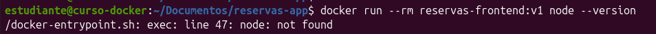

**Configuración en tiempo de ejecución y sin credenciales:**

- **Frontend:** `API_HOST`/`API_PORT` se sustituyen al arrancar ([ARQUITECTURA §1a](ARQUITECTURA.md#a-por-qué-el-frontend-se-configura-con-api_host-en-tiempo-de-ejecución-y-no-con-vite_api_url-en-tiempo-de-construcción)).
- **API:** lee `DB_*` y `PORT` del entorno; la versión entra como `ARG APP_VERSION` al construir
  (así se construyó `v2`).
- **Credenciales:** ninguna imagen las contiene. `.dockerignore` excluye `.env`, y las credenciales
  llegan por `.env` (Compose) o por el Secret (Kubernetes).
- **Usuarios:** ambas imágenes corren sin privilegios (`node` y `nginx`, UID 101).

### C2. Compose: la aplicación completa en una sola máquina

Red propia `reservas-net`, volumen `reservas-db-data` y comprobaciones de estado en las tres capas.
`depends_on` con `condition: service_healthy` ordena el arranque: base → API → frontend. Los tres
contenedores llegan a `(healthy)`; la base no publica puertos.

```
docker compose up -d
docker compose ps
```

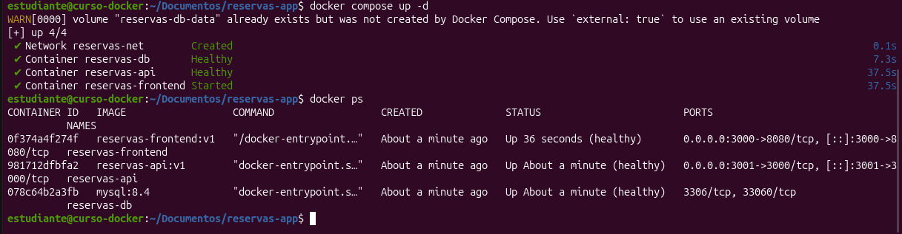

Gracias al orden por estado, la API se conecta a MySQL al primer intento, sin reintentos por
`ECONNREFUSED`:

```
docker compose logs -f reservas-api
```

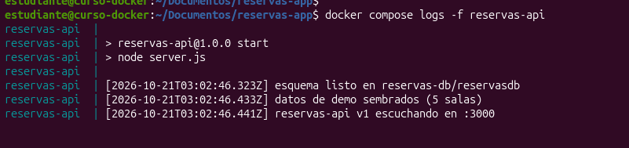

### C3. Manifiestos de Kubernetes: los 12 objetos

Release instalada con Helm en un namespace limpio. Se ven los 3 Deployments (con sus Pods y
ReplicaSets), los 3 Services (frontend `NodePort 30301`, API y base `ClusterIP`), el HPA con
`TARGETS` numérico, los 2 ConfigMaps, el Secret, el PVC `Bound` y el Ingress con `ADDRESS`.
(`kube-root-ca.crt` y `sh.helm.release.v1.*` los crean Kubernetes y Helm; no son del proyecto.)

```
kubectl get all,cm,secret,pvc,ingress,hpa -n reservas-app
```

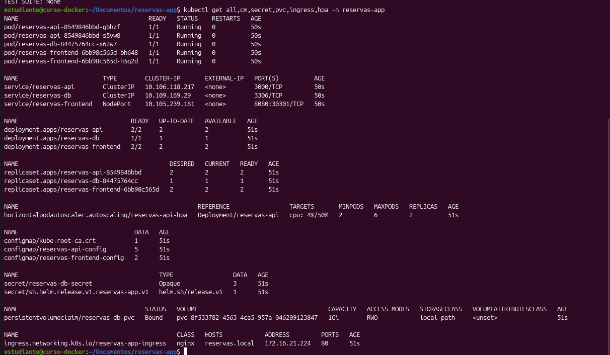

### C4. Configuración externalizada y persistencia

**Secret.** `reservas-db-secret` con 3 claves. Base64 no es cifrado: se decodifica directamente, y por
eso los valores del repositorio son de laboratorio ([ARQUITECTURA §4](ARQUITECTURA.md#gestión-externa-de-secretos)).

```
kubectl get secret
kubectl get secret reservas-db-secret -n reservas-app -o jsonpath='{.data.MYSQL_PASSWORD}' | base64 -d; echo
```

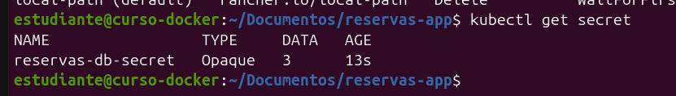

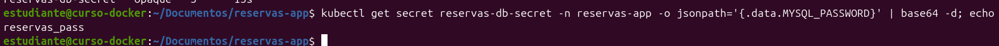

**PVC con `subPath`.** El Deployment de la base monta `reservas-db-pvc` en `/var/lib/mysql` con
`subPath: mysql` y queda en `Running` ([ARQUITECTURA §3.2](ARQUITECTURA.md#32-el-subpath-que-exige-el-directorio-de-datos-vacío-entrega-7)).

```
kubectl apply -f k8s/deploy-reservas-db.yaml
kubectl rollout status deployment/reservas-db -n reservas-app
```

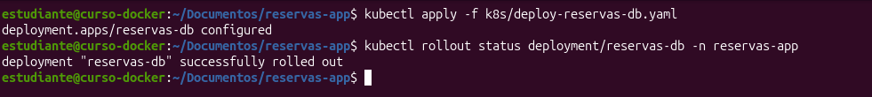

**Persistencia.** Se crea una reserva desde el navegador ("Sistemas Operativos – punto 6 tp 7", franja
10–12, Laboratorio de Redes), se borra el Pod de la base y el Deployment lo recrea. La reserva sigue
ahí: los datos viven en el PVC, no en el Pod.

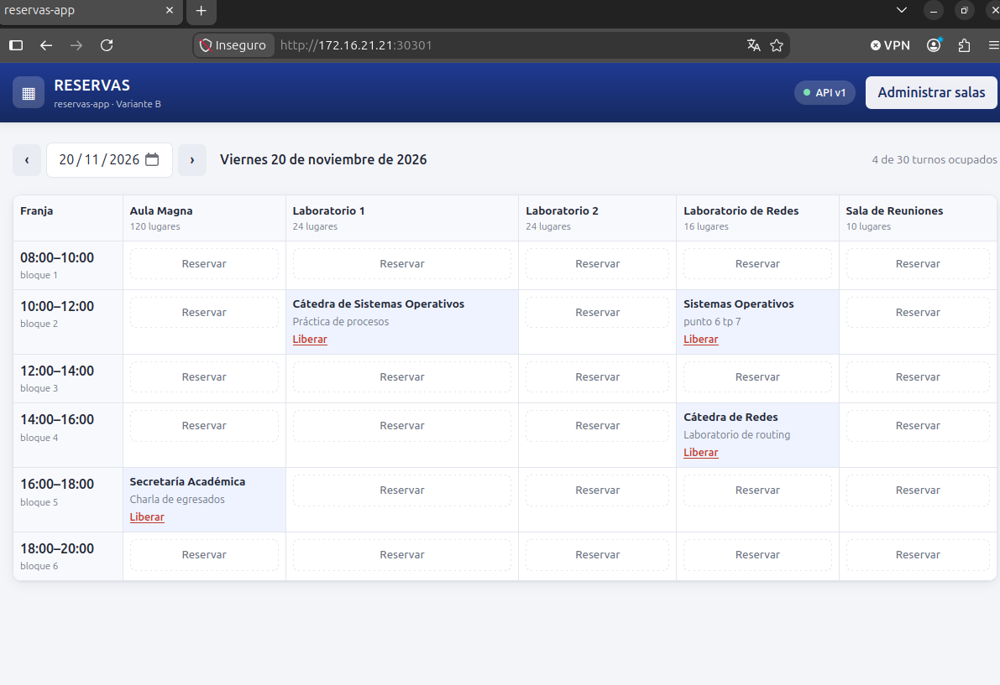

```
kubectl delete pod -l app=reservas-db -n reservas-app
kubectl get pods -n reservas-app -w
```

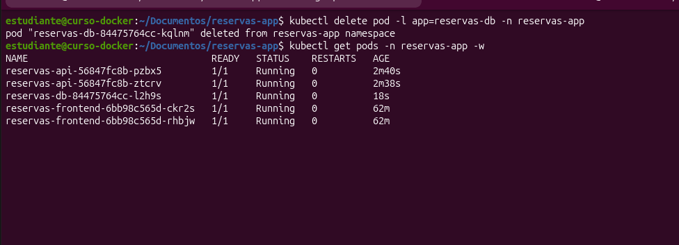

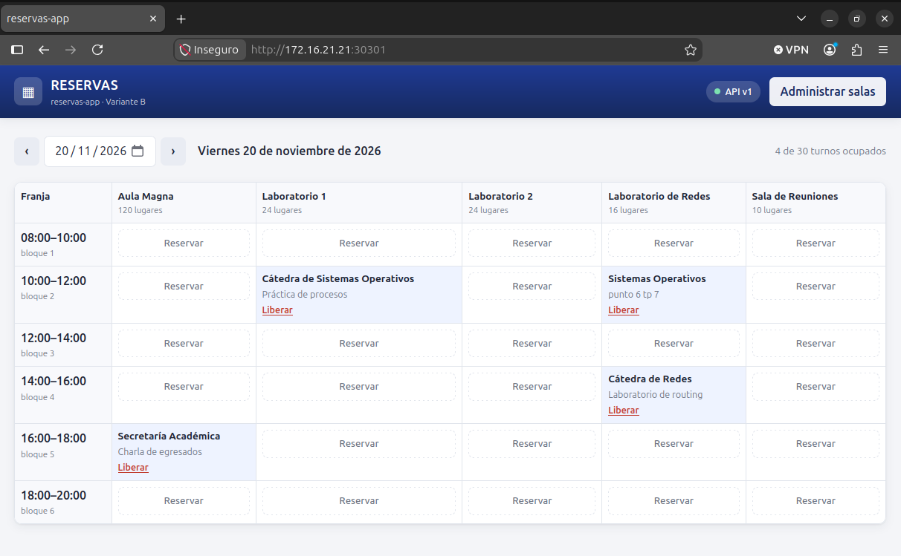

### C6. Empaquetado con Helm

`helm lint` sin errores y `helm template` renderiza exactamente **12** objetos (sin el NodePort de
depuración). Después se instala la release en un namespace limpio con `--create-namespace`.

```
helm lint ./reservas-app
helm template reservas-app ./reservas-app -n reservas-app | grep -E '^kind: '
helm template reservas-app ./reservas-app -n reservas-app | grep -E '^kind: ' | wc -l
```

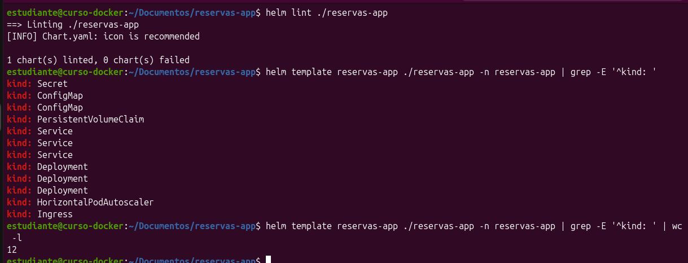

```
helm install reservas-app ./reservas-app -n reservas-app --create-namespace
```

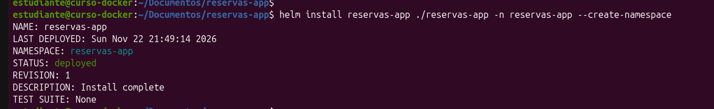

El ciclo completo de la release está en la [sección 3](#3-ciclo-de-vida-de-la-release-helm-upgrade-helm-rollback-y-helm-history)
y la prueba de que los parámetros son reales, en la [sección 4](#4-un-valor-de-valuesyaml-es-real-la-misma-plantilla-renderizada-dos-veces).
